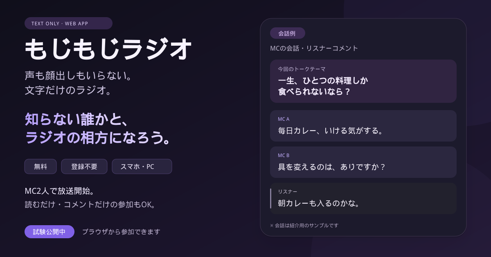

# もじもじラジオ｜文字だけの雑談Webアプリ

**[もじもじラジオを開く](https://yonayona-radio.onrender.com/)** — 無料・登録不要・マイクやカメラも不要です。

知らない相手と2人でMCになり、ランダムなお題で文字だけの掛け合いを楽しめます。放送中の番組には、リスナーとして読む・コメントする形でも参加できます。MCは2人の同時参加が必要で、相手がいないときは待機になります。

- [詳しい遊び方](https://tsukutta.app/stories/user-87d21bdd/mojimoji-radio-guide)
- [公式X・お知らせ](https://x.com/mojimoji_radio)

ホームでは、相手がいなくても架空の会話例を見られます。共有ボタンから、アプリのリンクを紹介できます。

声も顔出しもいらない、文字だけのラジオ。ランダムな相方と2人でMCになったり、リスナーとしてコメントしたりできる「もじもじラジオ」。

## 公開手順（Render + GitHub）
1. このZIPを解凍し、中のファイル（server.js, package.json, public/, render.yaml）をGitHubの新規リポジトリの**ルート**にアップロードします。個人情報やAPIキーは登録しないでください。
2. Renderにログインし、「New」→「Blueprint」を選び、GitHubのリポジトリを接続します。
3. render.yaml の設定を確認してデプロイします。無料プランが利用できない場合はプランを確認してから続行してください。料金が発生する選択は承認前に確認してください。
4. Renderに表示された `https://...onrender.com` のURLを開きます。
5. 異なるブラウザ2つで「ランダムマッチング」を押し、3つ目のブラウザからリスナーとして入ってテストします。

## ローカル起動
Node.js 18以上で `npm install` → `npm start` → http://localhost:3000

## 注意（一般公開前に必要）
- **試験版**です。公開用の安全対策（通報・ブロック、モデレーション、荒らし対策、利用規約、プライバシー方針）が未実装です。URLは信頼できるテスターだけに共有してください。
- アカウント・相互フォロー・ログ永続化・切断からの60秒復帰猶予は未実装です。通信切断で番組は即終了します。
- メッセージと部屋情報はサーバーのメモリ内だけにあり、再起動で消えます。複数インスタンスでは共有されません。
- 無料ホスティングはスリープや利用制限がある場合があります。提供条件は公開時に確認してください。
- このZIP自体をスマホで開くだけではオンライン通信は始まりません。サーバーへのデプロイが必要です。

## v0.3 テスト運用上の注意

- お題の連続変更を3秒間制限しています。
- アカウント・フォロー・通報・ブロックは未実装です。一般公開で不特定多数を募集する前に実装してください。
- Renderの無料プランはスリープ等の制限があります。
- GitHubへのアップロードはZIPを解凍し、フォルダ構造を維持してください。

## v0.3.1 修正

- 画面のJavaScript構文エラーを修正し、マッチング・送信などのボタン操作を復旧しました。
- マッチング待機中に切断した場合、ホームへ戻り、再接続後にやり直せます。
- 不正な形式の通信メッセージを受け取っても、サーバーが停止しないようにしました。
- `npm test` で画面の初期化と、MC2人・リスナー間の通信を検証できます。

## ホームと共有の改善

- 会話例、共有ボタン、初めての方向けの説明を追加しました。
- SNS共有用の紹介画像、favicon、canonical、robots.txt、sitemap.xmlを追加しました。
- 11/3のおためし集合時間は、日本時間の21:30以降に自動で非表示になります。
- `npm test`で、既存の会話機能と、画像配信・共有・集合時間の終了表示を確認できます。
